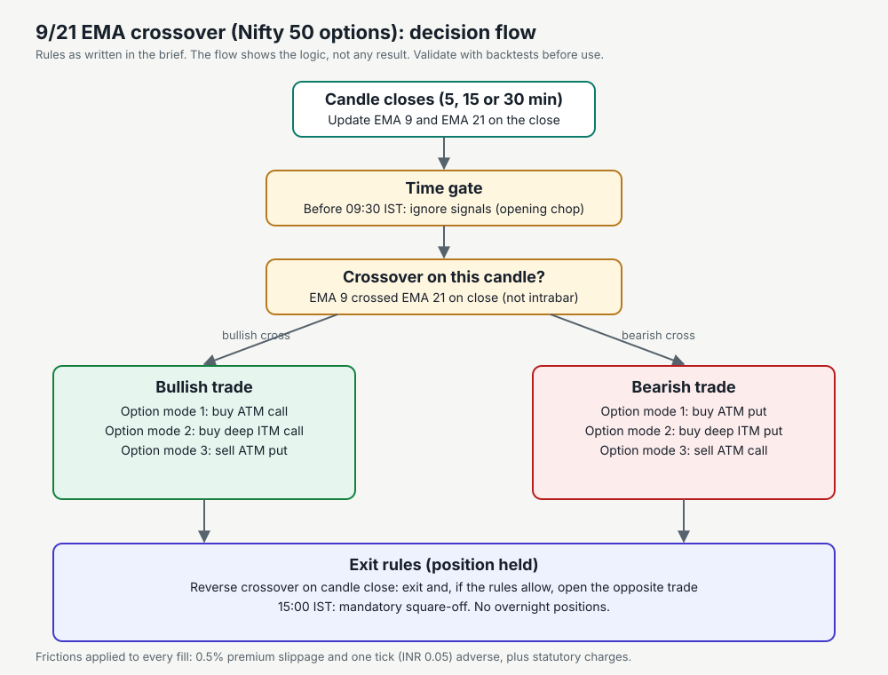
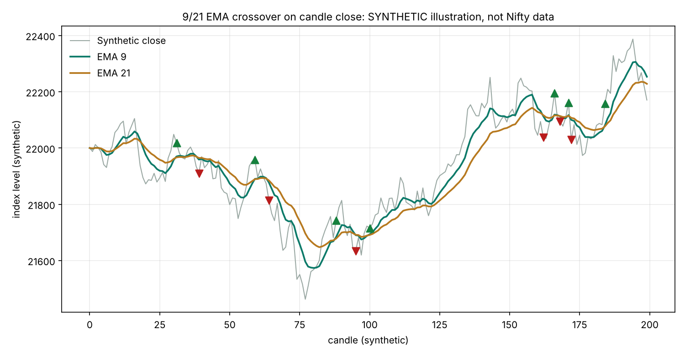

# Personal Trading & Analytics Terminal: Handbook

**Chapter:** Master Freelancing · Algorithmic trading systems
**Scope:** Architecture, security, data, option analytics, the 9/21 EMA crossover strategy, a friction-adjusted backtest, paper and live execution with guardrails, and the business and regulatory checks you need before you build or sell anything like this.
**Status of the strategy:** not proven. This handbook describes rules and a method to test them. No result, win rate or profit figure in this chapter is a finding. The only numbers are worked examples on synthetic or hypothetical inputs.

---

## Read this first

- **Risk.** Options are leveraged and can lose all the premium paid. Selling options can lose far more than the premium received. A strategy that looks good on past data can fail on new data. You can lose money on every trade in this handbook.
- **Not advice.** This is an engineering and learning guide. It is not investment, tax or legal advice.
- **Labels used below.** **[Fact]** is a standard definition or formula. **[Check]** must be confirmed on an official page before you rely on it (charges, lot sizes, rules, APIs). **[Assumption]** is a value chosen for the worked examples. **[Opinion]** is a design recommendation.

---

## Chapter 0: Can this be done on Claude?

**Short answer:** Claude can write the code, the tests, the documentation and the diagrams for this system. Claude cannot run the live trading part for you. Two different tools are involved.

| Task | In Claude chat or Artifacts | In Claude Code on your own computer |
|---|---|---|
| Write the modules, tests and documentation | Yes | Yes, and it can run the tests in your project folder |
| Run a backtest on data you provide (CSV) | Yes, for small files, in a browser artifact or a file upload | Yes, on the full dataset |
| Show a dashboard | Yes, as a static or client-side page with sample or uploaded data | Yes, served on `127.0.0.1` on your machine |
| Hold your broker password, TOTP secret or API key | **No. Never paste them into a chat.** | Yes, in a local `.env` file that is never committed |
| Connect to your broker and place orders | **No.** A cloud sandbox has no secure connection to your account and is the wrong place for live orders | Yes, from your machine, behind the guardrails in Chapter 9 |
| Keep a static IP that the broker can whitelist | **No** | Only if the machine or server has a fixed public IP (your own router, a VPS) |
| Run a 24/7 WebSocket feed and Telegram bot | **No** | Yes, on a server or PC that stays on during market hours |

**What to do:** build the project in a folder on your own computer, with Claude Code or your editor, and keep the secrets on that computer only. Use Claude for code review, tests and documentation. Do not publish a page that displays a live account, a token or a broker session.

**Two things Claude cannot promise:** that the strategy makes money, and that the broker's API, charges or regulations are what this handbook says. Check both yourself.

---

## Chapter 1: Scope, regulation and the business question

### 1.1 Regulatory checks before any live use **[Check]**
- **Personal use:** placing your own orders through your own broker account is different from running a service for others. Read your broker's API terms and any algorithmic-trading rules that apply to retail users in India (SEBI and the exchanges have issued rules on algorithmic trading and on broker APIs; confirm the current version).
- **Selling or sharing:** giving other people trading signals or managing their money can require registration as a research analyst or investment adviser with SEBI. Do not sell signals or manage other people's money without legal advice.
- **Data:** market data licences and the broker's terms govern how you can store, display and redistribute prices.

### 1.2 Business angle (freelancing)
The skills in this project transfer to paid work that does not give investment advice: building internal dashboards for a finance team, writing data pipelines and reconciliation checks, building backtesting infrastructure for a research team, and automating reports. A client who wants a "signal service" is a regulatory question first and a technical question second.

---

## Chapter 2: Architecture

### 2.1 Directory structure (target)
```
trading-terminal/
  backend/        FastAPI or Flask server, broker connectors, WebSocket handlers, quant modules
  database/       Postgres schema (candles, option chain, journal), Redis cache manager
  frontend/       dashboard: plain JavaScript with Tailwind, or a light React app
  strategies/     backtest engine, signal generator, paper and live execution
  alerts/         Telegram bot and notification dispatcher
  tests/          unit tests for maths, cost model and guardrails
  .env            secrets (never committed; see Chapter 3)
  .gitignore      must list .env, *.csv with broker data, and logs
```

### 2.2 Components and data flow
```
Broker REST ──► history download, margin snapshot, order dispatch ──► Postgres (candles, journal)
Broker WebSocket ──► ticks, depth, option prices ──► Redis pub/sub ──► dashboard (WebSocket)
                                        │
                              strategy engine on candle close
                                        │
               paper ledger  ◄── mode B        mode C (guarded) ──► broker order API
                                        │
                     Telegram alerts ◄──┴──► [Execute] / [Skip] buttons ──► backend
```

### 2.3 Modes of operation
| Mode | What runs | Money at risk |
|---|---|---|
| A. Backtest | Historical candles and option prices, no clock | None |
| B. Forward paper | Live ticks, simulated fills in a virtual ledger | None (but test the data feed carefully) |
| C. Live routing | Real orders through the broker API | Yes |

Move from A to B to C in that order. Do not skip B. Use C only with small size after B has run for weeks with a clean record.

### 2.4 Market hours and states **[Check: exchange calendar]**
- Regular session for NSE and F&O: 09:15 to 15:30 IST, Monday to Friday, excluding exchange holidays.
- Outside those hours the terminal shows **"Market Closed"** and does not generate trades.
- Pre-open and special sessions have different rules. Do not trade them with this strategy.

---

## Chapter 3: Security and credentials

### 3.1 Where secrets live
- All secrets (broker credentials, TOTP secret, API keys, database URL, Telegram bot token, the allowlisted Telegram user IDs) live in a **local `.env` file** on your computer.
- Never hard-code them. Never print them in logs. Never paste them into a chat, a ticket or a screenshot.
- Set file permissions so only your user can read it (on Linux and macOS: `chmod 600 .env`).
- A `keys.txt` file, as one prompt suggests, is the same risk in a different file name. If you use one, apply the same rules: outside any repository, read-only to your user, and deleted once you have moved the values into a secrets store.

### 3.2 TOTP auto-login **[Check: broker terms]**
- A TOTP (time-based one-time password) is a six-digit code that changes every 30 seconds. Some brokers let an app generate it from a shared secret, which can automate daily login.
- **Risk:** the TOTP secret is as sensitive as the password. Anyone holding it can log in as you. Automating login may also be prohibited by the broker's terms. Check before you build it.
- Store the session token in memory or in an encrypted store, with an expiry. Re-authenticate when it expires. Never write a live token to a log or a browser page.

### 3.3 Static IP
Brokers that require a registered static IP for API orders will reject requests from any other address. Your code can check its own public address and refuse to place orders if it does not match the registered one. That is a safety check, not a substitute for the broker's own rule. **[Check: the current SEBI and broker static-IP requirement for retail API orders.]** A home connection with a changing IP fails this check; a fixed-IP server is the usual fix.

### 3.4 Web security for the dashboard
- Bind the server to `127.0.0.1`, not `0.0.0.0`, unless you have authentication and HTTPS in front of it.
- Require a login for any page that shows balances or positions.
- Use CSRF protection on every state-changing request (orders, mode switches, confirmations).
- Set `Content-Security-Policy` headers and avoid inline scripts that take untrusted input.

---

## Chapter 4: Data layer

### 4.1 PostgreSQL schema (outline)
```sql
CREATE TABLE candles (
  symbol     TEXT        NOT NULL,        -- e.g. NIFTY, BANKNIFTY, CRUDEOIL, SILVER
  instrument TEXT        NOT NULL,        -- 'INDEX' | 'FUT' | 'OPT'
  expiry     DATE,                        -- NULL for index
  strike     NUMERIC(12,2),               -- NULL for index and futures
  option_type CHAR(2),                    -- 'CE' | 'PE' | NULL
  timeframe  TEXT        NOT NULL,        -- '1s' | '1m' | '5m' | '15m' | '30m'
  ts         TIMESTAMPTZ NOT NULL,        -- candle open time, stored in UTC
  open NUMERIC(12,2), high NUMERIC(12,2), low NUMERIC(12,2), close NUMERIC(12,2),
  volume BIGINT, oi BIGINT,
  PRIMARY KEY (symbol, instrument, COALESCE(expiry,'1900-01-01'), COALESCE(strike,0), COALESCE(option_type,''), timeframe, ts)
);
CREATE INDEX candles_ts ON candles (symbol, timeframe, ts);
```
- Store times in UTC and convert to IST for display. Mixing the two is a classic source of wrong 9:30 and 15:00 gates.
- Keep expired option contracts. Survivorship bias (testing only contracts that still exist) inflates results.
- One-second candles for two years on several instruments is large. Partition by month or use a time-series extension if you need it, and do not store ticks you never use.

### 4.2 Redis
- Use Redis pub/sub for live fan-out: one channel per instrument for ticks, one for depth, one for portfolio mark-to-market (M2M).
- Redis is a cache and message bus, not the system of record. The journal lives in Postgres or SQLite.
- Set expiry on cached snapshots so a stalled feed does not look live.

### 4.3 Data quality checks (run on every download)
- No gaps in 1-minute bars during market hours (or a known holiday list explains them).
- High ≥ max(open, close) and low ≤ min(open, close) on every bar.
- No duplicate timestamps for the same contract.
- Option strikes exist for the expiry and the chain is complete around ATM.
- Volume and OI are non-negative. OI change matches the previous day's OI.

---

## Chapter 5: Broker integration (dual feed)

### 5.1 REST
- Historical candles, margin and balance snapshots, order placement and status.
- Rate limits: queue requests and back off on HTTP 429. Log every response code.

### 5.2 WebSocket
- High-throughput tick and depth feed. Subscribe only to instruments you use; a 500-strike chain subscribed by default is a common cause of dropped messages.
- Reconnect with exponential backoff (1 s, 2 s, 4 s… capped at 60 s) and re-subscribe after each reconnect.
- Detect stale data: if no tick arrives for N seconds during market hours, show a warning and stop generating trades.

### 5.3 Error states the code must handle
| Error | Required behaviour |
|---|---|
| Broker disconnect | Mark feed "disconnected", stop new signals, keep existing positions visible, alert on Telegram |
| Session token expired | Re-authenticate once; if that fails, stop live routing and alert |
| Market closed | Show "Market Closed"; no signals, no orders |
| Missing strike data | Skip the contract, log it, never fill with a guessed price |
| Order rejected | Record the broker's reason in the journal; do not retry blindly |
| Partial fill | Track filled quantity; the position is only as big as the fill |
| Stale price | Refuse to route an order priced from data older than the threshold |

---

## Chapter 6: Dashboard

### 6.1 Watchlist and charts
- Multi-asset watchlist: Nifty 50, F&O stocks, MCX commodities (crude oil, silver). Confirm each contract's symbol and lot size on the exchange.
- Candlestick chart with 9 EMA and 21 EMA overlays and markers for entries and exits. **[Check]** the TradingView Lightweight Charts licence (Apache 2.0 at the time of writing) and its current API.

### 6.2 Order book (market depth)
Top five bids and asks with quantity and orders. Depth is only meaningful during live sessions; show "no depth" outside them.

### 6.3 Option chain and Greeks
- Current-week and next-week expiries; strikes around ATM (for example ±10 strikes).
- Per strike: LTP, bid, ask, OI, OI change, IV, delta, gamma, theta, vega.
- Greeks are computed locally with Black-Scholes (Chapter 7). Label them as model values, not vendor values.

### 6.4 Statistical spot profiling (0DTE)
For expiry days, compute from history:
- **Intraday range:** (day high − day low) ÷ day open, averaged, in percent and in points.
- **Gap-up / gap-down probability:** share of days where the open is above (below) the previous close by more than a threshold you set. Define the threshold before you look at results.
- **Probability an OTM strike expires worthless:** for each OTM strike (for example 100, 200, 250 points away), the share of expiry days where the settlement price was below that strike (for a call) or above it (for a put). Use settlement prices from expired contracts. Report sample size with every number.

---

## Chapter 7: Black-Scholes Greeks (method and code)

### 7.1 Formulas **[Fact]**
For a European call with spot S, strike K, time to expiry T (years), risk-free rate r, dividend yield q, volatility σ:

- d1 = [ln(S/K) + (r − q + σ²/2)·T] / (σ√T)
- d2 = d1 − σ√T
- Call = S·e^(−qT)·N(d1) − K·e^(−rT)·N(d2)
- Put = K·e^(−rT)·N(−d2) − S·e^(−qT)·N(−d1)
- Delta: call e^(−qT)N(d1); put −e^(−qT)N(−d1)
- Gamma = e^(−qT)·φ(d1) / (Sσ√T)
- Vega = S·e^(−qT)·φ(d1)·√T (per 1 vol point after dividing by 100)
- Theta (per day): divide the annual theta by 365

N is the standard normal cumulative distribution; φ is its density.

### 7.2 Implied volatility **[Fact]**
Implied volatility (IV) is the σ that makes the model price equal the market price. There is no closed form; the code uses bisection between no-arbitrage bounds. Check the model price against the market before trusting the IV, because a stale or illiquid quote gives a meaningless IV.

### 7.3 Code and tests
The reference implementation is `code/bs.py` with tests in `code/test_bs.py`. The tests check put-call parity, a textbook value (S = K = 100, T = 1, r = 5%, σ = 20%, call ≈ 10.4506), delta relations, gamma and vega equality, and an implied-volatility round trip.

Worked example (synthetic inputs: S = 22,000, K = 22,100, 5 days to expiry, r = 6.5%, σ = 14%): call delta ≈ 0.415, gamma ≈ 0.0011, theta ≈ −15.7 per day, vega ≈ 10.0 per vol point.

---

## Chapter 8: Strategy: 9/21 EMA crossover

### 8.1 Rules as specified
- **Underlying:** Nifty 50 index. Indicators are computed on the index, not on the option.
- **Bullish signal:** EMA 9 crosses above EMA 21 **on a candle close**.
- **Bearish signal:** EMA 9 crosses below EMA 21 **on a candle close**.
- **Bullish trade options:** buy ATM call, buy deep in-the-money call, or sell ATM put.
- **Bearish trade options:** buy ATM put, buy deep in-the-money put, or sell ATM call.
- **Entry window:** no new entries before 09:30 IST (09:15–09:30 is excluded as opening chop).
- **Exit:** reverse crossover on candle close, or the mandatory square-off at 15:00 IST. No overnight positions.
- **Timeframes to compare:** 5-minute, 15-minute and 30-minute candles.

The one-prompt version said "ignore 9:15 to 9:30". The other said "after 9:30". Both mean the same gate; the code uses 09:30.

### 8.2 The flow (image)


*Figure 1. The rule flow as written. It shows the logic, not any result.*

### 8.3 What a crossover looks like (synthetic)


*Figure 2. Synthetic random-walk prices with EMA 9 and EMA 21. The triangles mark confirmed crossovers on candle close. This is not Nifty data and says nothing about profitability.*

### 8.4 Why a crossover strategy needs friction and testing
- In a range-bound market, EMAs cross often and each cross is a loss after costs. These are **whipsaws**. Count them separately (the reference code has `whipsaw_count`).
- An option buy loses to time decay even when the index moves the right way slowly. Theta matters most on expiry days.
- An ATM option sell collects premium but has large or unlimited loss in a fast move. Naked short options need margin, stop rules and a plan for a gap. Without those, one bad day can wipe out many good ones.
- A deep in-the-money option behaves more like the underlying (higher delta) but costs more premium and carries more capital per trade.

### 8.5 Operational guardrails in the strategy
- Signals only on closed candles. Never act on the forming candle, because the close is not known until the candle ends.
- Enter on the next candle's open (or a defined fill rule). Using the same candle's close as the fill is look-ahead bias.
- One position at a time per strategy unless you explicitly test otherwise.
- Hard stop at 15:00 IST regardless of signal.

---

## Chapter 9: Backtesting, costs and scorecards

### 9.1 Data you need
- Index 1-minute candles, two years, Nifty 50 (and the timeframes you compare, aggregated from 1-minute).
- Option premiums for the ATM, deep ITM and chosen strikes at each relevant minute, including expired contracts.
- Lot sizes and expiry calendar for each period. **[Check: NSE lot sizes change over time.]**
- Charges schedule for each period. **[Check]**

**Availability:** whether the broker API provides two years of one-minute index and option history, and for expired contracts, is **[Check]**. If it does not, say so in the report; do not fill the gap with simulated premiums and present them as history.

### 9.2 Engine rules that prevent false results
1. Signal on candle close, fill on the next candle (see 8.5).
2. Use the option price at the fill time, not the index price.
3. Apply frictions to every fill (9.3).
4. Include expired contracts and the exact expiry calendar.
5. Split the data: optimise on one period, test on a later period that was not used for any choice. Report both.
6. Do not tune EMA lengths, time gates and strike offsets until one combination looks good. Test a small grid and report all of it.
7. Report sample size and the number of parameter combinations tried.

### 9.3 Friction model
For each fill:
- **Premium slippage:** 0.5% adverse. A buy fills at premium × 1.005; a sell fills at premium × 0.995.
- **Tick penalty:** one tick (₹0.05) adverse on each fill, so buy + 0.05 and sell − 0.05.
- **Brokerage:** per order **[Check: your broker's plan]**.
- **STT:** on option premium, on the sell side **[Check: the current rate and base. The brief says "sell value"; confirm the base the exchange uses.]**
- **Exchange transaction charge, SEBI fee, stamp duty (buy side), GST on brokerage and fees.** **[Check each rate.]**

All rates are constants in `code/strategy_reference.py` (`CHARGES`). Change them there once you have verified them, and rerun the tests.

Worked example (hypothetical, 75 units, buy at 100, sell at 110): entry fill 100.55, exit fill 109.40, gross 750.00, price frictions 86.25, charges 62.16, net 601.59. The charge figures use the placeholder rates above, so the net is illustrative only.

### 9.4 KPI definitions
| KPI | Definition |
|---|---|
| Total trades | Count of closed trades |
| Win / loss count | Trades with net > 0 / net < 0 |
| Win rate | wins ÷ total trades |
| Gross PnL | Sum of (exit − entry) × quantity before frictions |
| Charges | Sum of brokerage, STT, exchange, SEBI, stamp and GST |
| Net PnL | Gross − price frictions − charges |
| Profit factor | sum of winning net PnL ÷ absolute sum of losing net PnL |
| Payoff ratio | average win ÷ average loss |
| Expectancy | net PnL ÷ number of trades (the average result per trade) |
| Max drawdown | the largest fall from a peak in cumulative net PnL |
| Whipsaws | losing trades closed within a few candles by a reverse crossover |

Read the scorecard with the sample size. Fewer than about 30 trades is too few to say much; the code adds a warning.

### 9.5 The three option modes
Compare them on the same signals and the same costs:
1. **ATM option buy:** limited loss (the premium), theta works against you, needs a sharp move.
2. **Deep ITM option buy:** higher delta, less time-value decay, more capital per trade.
3. **ATM option sell:** collects premium, unlimited or large loss in a fast move; needs margin and a stop plan.

A mode can look best on one timeframe and worst on another. Report the full grid, not the best cell.

---

## Chapter 10: Execution, paper trading and live routing

### 10.1 Paper trading (Mode B)
- Runs during 09:15 to 15:30 IST on live ticks. Generates signals on candle close and records simulated fills with the frictions from Chapter 9.
- Writes to a virtual ledger and to the same journal as live trades, tagged `PAPER`.
- Outside market hours it shows "Market Closed" and does nothing else.

### 10.2 Live routing (Mode C) and the guardrails
Use **two independent guardrails**, and make both required:

1. **Environment flag.** The server refuses to enable live routing unless the variable is set when it starts. Pick one name and use it everywhere. The two prompts this chapter draws on name it differently (`TERMINAL_LIVE_TRADING=1` in one, `EMA_LIVE=1` in the other). **[Decision needed: choose one.]**
2. **Typed confirmation.** The UI asks you to type a fixed phrase before a live session starts. The two prompts use different phrases (`CONFIRM TRADE` and `trade live`). Choose one. Typing it is a deliberate act, so do not make the phrase a single button.

Add a third layer that most tutorials leave out:
3. **Static IP check.** Confirm the outbound IP matches the registered address before every live session, and refuse if it does not.

Also add:
- A **kill switch** that stops all new orders and flattens the book, reachable from the dashboard and from Telegram.
- A **per-day loss limit** and a **per-trade maximum quantity**. When either is hit, live routing stops until you reset it.
- **Order confirmation for each trade** (Telegram `[Execute]` / `[Skip]`) in semi-automated mode. Verify the callback comes from your user ID; do not trust the button data alone.

### 10.3 Telegram
- A bot token and a list of allowed Telegram user IDs in `.env`. Ignore messages from any other ID.
- Alerts: trade trigger, large IV change, a one-minute M2M update, feed disconnected, order rejected.
- `[Execute]` and `[Skip]` buttons call the backend with a signed, single-use trade ID that expires after a few seconds.

### 10.4 Trade journal
Every paper and live order is written to one table (Postgres or SQLite) with:
Timestamp (IST and UTC), mode (`PAPER`/`LIVE`), strategy name ("9/21 EMA Crossover"), timeframe, underlying price at trigger, strike, option type (CE/PE), side, quantity, expected price, fill price, slippage incurred (in INR), charges, realised net PnL, and the broker order ID.

Journal entries are append-only. A correction is a new row that references the old one.

---

## Chapter 11: Build plan (30 days)

| Week | Goal | Done when |
|---|---|---|
| 1 | Project skeleton, `.env` loading, tests for the maths and cost model | `pytest` passes; no secret in the repo |
| 2 | Data download and quality checks; Postgres schema loaded | 2 years of 1-minute index data loaded; quality report clean |
| 3 | Backtest engine on the strategy; scorecards; three timeframes and three option modes | Scorecard produced for each combination, with sample sizes |
| 4 | Dashboard (charts, watchlist, scorecard), paper mode, journal | Paper trading runs for a full market day with a clean journal |

Then: at least four more weeks of paper trading before any live routing, and a written review of the paper results against the backtest. If they disagree, find out why before going further.

---

## Chapter 12: Testing and release checklist

- [ ] Unit tests pass for EMA, crossovers, fills, charges, scorecard and Black-Scholes.
- [ ] Put-call parity and implied-volatility round trip pass.
- [ ] Backtest reports the friction model and the sample size.
- [ ] Out-of-sample period was not used to choose parameters.
- [ ] Paper trading has run long enough to show the feed handles disconnects.
- [ ] Missing strikes, stale prices and rejected orders are handled and logged.
- [ ] Live routing is off by default. Both guardrails and the static IP check are tested to block an order.
- [ ] Kill switch works from the dashboard and from Telegram.
- [ ] `.env` is not in version control; secrets were rotated after any accidental exposure.
- [ ] The dashboard is bound to `127.0.0.1` or behind authentication and HTTPS.

---

## Chapter 13: Glossary

| Term | Meaning |
|---|---|
| ATM | At-the-money: strike closest to the spot price |
| ITM / OTM | In-the-money / out-of-the-money: a call is ITM when spot is above strike; a put is ITM when spot is below strike |
| CE / PE | Call option / put option |
| 0DTE | Zero days to expiry: the contract expires that day |
| Delta | Change in option price for a 1-point move in the underlying |
| Gamma | Change in delta for a 1-point move in the underlying |
| Theta | Change in option price per day from the passage of time (usually negative for long options) |
| Vega | Change in option price for a 1-point change in volatility |
| IV | Implied volatility: the volatility that matches the market price in the model |
| OI | Open interest: number of contracts open |
| EMA | Exponential moving average: a moving average that weights recent prices more |
| Crossover on close | A signal confirmed only when the candle closes |
| Whipsaw | A false signal that reverses quickly and loses money |
| Slippage | The gap between the expected and actual fill price |
| Tick | The smallest price step (₹0.05 in this brief) |
| STT | Securities Transaction Tax, a statutory charge in India |
| Profit factor | Gross winning PnL divided by gross losing PnL |
| Expectancy | Average net result per trade |
| Max drawdown | Largest peak-to-trough fall in cumulative PnL |
| M2M | Mark-to-market: the current value of open positions |
| Pub/sub | A messaging pattern where publishers send to channels and subscribers receive them |
| WebSocket | A two-way connection for streaming messages |
| TOTP | Time-based one-time password, a six-digit code that changes every 30 seconds |
| Static IP | A fixed public address used for broker API requests |
| Look-ahead bias | Using information that would not have been known at the time of the decision |
| Survivorship bias | Testing only instruments that still exist, which flatters results |
| Out-of-sample | Data not used to choose the strategy's parameters |

---

## Learning tools and links

- NSE India (market data, lot sizes, holidays, circulars): https://www.nseindia.com
- SEBI (regulation, algorithmic trading and investment advice rules): https://www.sebi.gov.in
- Black-Scholes model overview (for the maths, read an introductory text, then check any formula against the code tests): https://en.wikipedia.org/wiki/Black%E2%80%93Scholes_model
- TradingView Lightweight Charts documentation: https://tradingview.github.io/lightweight-charts/
- FastAPI documentation: https://fastapi.tiangolo.com
- Flask documentation: https://flask.palletsprojects.com
- PostgreSQL documentation: https://www.postgresql.org/docs/
- Redis documentation (pub/sub): https://redis.io/docs/
- Telegram Bot API: https://core.telegram.org/bots/api
- Groww API developer documentation: **[Check: locate the official developer portal and its current terms]**

---

## Sources and disclosure

- This handbook is based on the feature list and rules in the brief supplied with it. No broker, exchange or regulator document was opened while writing it; every item marked [Check] must be confirmed against the official page.
- The code in `code/` was tested with its own unit tests. It has not been run against any live broker, and it does not include any broker connector.
- Figures in worked examples are hypothetical or synthetic.
